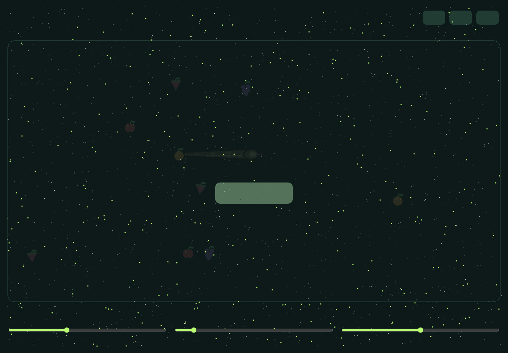

# Orchard Snake

Jeu interactif en p5.js illustrant le comportement de pilotage **Arrival** décrit par Craig W. Reynolds. Le joueur guide un serpent avec la souris pendant une manche de 60 secondes. La tête suit le pointeur, les anneaux suivent leur prédécesseur, et les fruits proches sont attirés vers la tête.

Le projet transforme un exemple pédagogique de steering behavior en petit jeu complet : score, meilleur score persistant, plusieurs serpents, paramètres réglables, texte animé et musique générée avec Web Audio.

## Démonstration

- [Jouer en ligne](https://itsghali.github.io/orchard-snake/)
- [Code source](https://github.com/itsghali/orchard-snake)



## Jouer

1. Ouvrir le jeu depuis GitHub Pages, ou servir ce dossier avec un serveur HTTP.
2. Attendre que le texte animé termine sa formation.
3. Cliquer sur **START**.
4. Déplacer la souris dans l’arène pour guider le serpent.
5. Collecter les fruits avant la fin des 60 secondes.

Commandes :

| Entrée | Action |
|---|---|
| Souris / toucher | Déplacer la cible de la tête |
| `Espace` | Ajouter un serpent, maximum 8 |
| `B` | Augmenter la vitesse |
| `S` | Réduire la vitesse |
| `M` | Activer ou couper la musique |
| Bouton HOLD | Mettre en pause / reprendre |
| Bouton RESET | Réinitialiser la manche |

Les curseurs règlent vitesse, longueur et largeur du serpent.

## Exécution locale

Prérequis : Git, un navigateur moderne et Python 3.

```bash
git clone https://github.com/itsghali/orchard-snake.git
cd orchard-snake
python -m http.server 8000
```

Sous Windows, si la commande `python` n'existe pas, utiliser `py -m http.server 8000`. Sous macOS ou Linux, utiliser `python3 -m http.server 8000` si nécessaire.

Ouvrir `http://localhost:8000`.

L’ouverture directe de `index.html` peut fonctionner, mais un serveur HTTP reproduit mieux le comportement de GitHub Pages et les politiques audio du navigateur.

## Principe algorithmique

### Modèle de Reynolds

Chaque entité visible est un `Vehicle`. Son état contient position, vitesse et accélération sous forme de `p5.Vector`.

Un comportement calcule une force sans déplacer directement l’entité :

```text
direction = cible - position
vitesseDésirée = direction normalisée × maxSpeed
steering = vitesseDésirée - vitesseActuelle
steering limité à maxForce
```

La force passe ensuite par `applyForce()`. `Vehicle.update()` applique accélération, vitesse et position. Cette séparation conserve trois responsabilités : objectif, pilotage, locomotion.

### Arrival

`seek` garde normalement une vitesse maximale jusqu’à la cible. `arrive` réduit progressivement la vitesse désirée dans une zone de freinage. L’entité converge donc vers la cible sans arrêt brutal.

Pour un anneau, une distance d’équilibre est fournie à `arrive` :

- trop loin du précédent : accélération vers lui ;
- distance correcte : vitesse désirée proche de zéro ;
- trop près : vitesse désirée inversée pour recréer l’espacement.

Les anneaux possèdent une réserve de vitesse et de force supérieure à celle de la tête. Ils peuvent ainsi rattraper leur prédécesseur après un virage, sans propager une oscillation jusqu’à la queue.

### Composition des comportements

La tête combine deux objectifs dans `arrivalBehaviors.js` :

- pointeur du joueur : poids `0,3` lorsqu’un fruit est proche ;
- fruit le plus proche dans un rayon de 115 px : poids `0,7`.

La somme est limitée à `maxForce`. Sans fruit proche, la tête suit uniquement le pointeur.

Le fruit applique `arrive` vers la tête lorsqu’elle entre dans son rayon d’attraction. Sinon, il freine sa vitesse courante. Le comportement du fruit reste indépendant de sa locomotion.

### Texte animé

`pixelText.js` décrit chaque caractère par une grille 5 × 7. Un `TextPixel`, lui-même sous-classe de `Vehicle`, est créé uniquement pour chaque cellule occupée. Chaque pixel rejoint sa position cible avec `arrive`.

Le passage de la souris crée une répulsion locale dans un rayon de 72 px. Seuls les pixels proches sont dispersés ; ils reviennent ensuite vers leur caractère avec Arrival.

### Jeu et score

- Manche : 60 secondes.
- Neuf fruits maintenus dans l’arène.
- Valeurs possibles : 10, 15, 20 ou 25 points.
- Un fruit ne peut être compté qu’une fois grâce au drapeau `eaten`.
- Le meilleur score est conservé dans `localStorage` sous la clé historique `arrival-orchard-best`.
- L’apparition d’un fruit tente de conserver au moins 160 px avec la tête.

## Architecture

| Fichier | Responsabilité |
|---|---|
| `index.html` | Chargement des scripts, contrôles accessibles |
| `sketch.js` | États du jeu, boucle p5, entrées, interface |
| `vehicle.js` | Locomotion fournie et comportement `arrive` |
| `arrivalBehaviors.js` | Forces indépendantes tête, anneau et fruit |
| `Snake.js` | Composition tête + chaîne d’anneaux |
| `SnakeHead.js` | Entité tête et rendu |
| `AnneauSnake.js` | Entité anneau et rendu |
| `Food.js` | Fruits animés et attraction |
| `gameState.js` | Score, stockage et apparition des fruits |
| `TextPixel.js` | Particule de texte pilotée par Arrival |
| `pixelText.js` | Glyphes 5 × 7 et gestion des pixels |
| `GameMusic.js` | Musique procédurale Web Audio / WebAudiox |
| `tests/arrival-game.test.mjs` | Tests unitaires et smoke test |

Spécification technique complète : [SPECIFICATIONS.md](SPECIFICATIONS.md).

Diagnostic des problèmes et corrections : [PROBLEMES-ET-SOLUTIONS.md](PROBLEMES-ET-SOLUTIONS.md).

## Tests

```text
node --test tests/arrival-game.test.mjs
```

La suite vérifie notamment :

- héritage de `Vehicle` pour toutes les entités visibles ;
- calcul des forces sans déplacement direct ;
- limitation à `maxForce` ;
- stabilisation des anneaux sans oscillations répétées ;
- attraction et freinage des fruits ;
- score et stockage robuste ;
- quantité exacte de pixels par glyphe ;
- formation et dispersion locale du texte ;
- reprise audio et mute ;
- bornes des contrôles ;
- exécution de `setup()` et de plusieurs frames sans exception.

## Technologies

- JavaScript sans framework
- p5.js
- Web Audio API
- WebAudiox, licence MIT
- Node.js Test Runner pour les tests

Licences et provenance : [THIRD-PARTY-NOTICES.md](THIRD-PARTY-NOTICES.md).

## Limites

- Le son exige une interaction utilisateur à cause des règles d’autoplay des navigateurs.
- Le meilleur score dépend du navigateur, du domaine et du stockage local.
- Le jeu est conçu pour une démonstration pédagogique, pas pour une physique de serpent biologique.

## Référence

Craig W. Reynolds, *Steering Behaviors for Autonomous Characters*, GDC 1999.

`vehicle.js` reste le code de base fourni et n’a pas été modifié pour cette publication.
